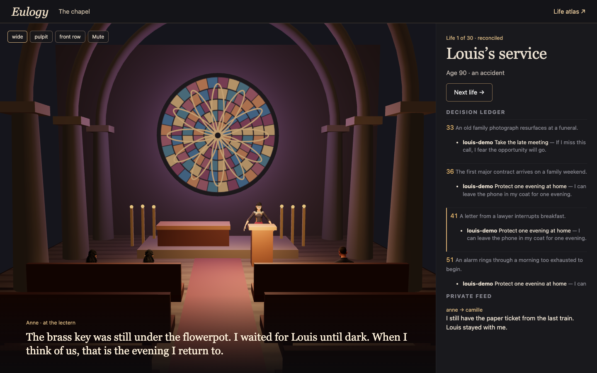
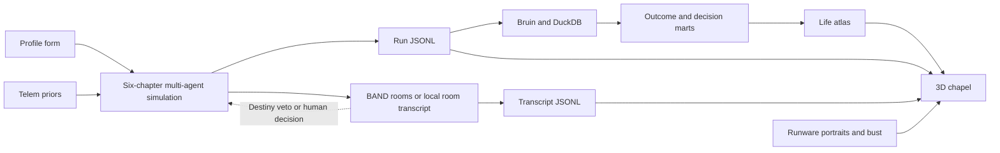

# Eulogy

[](https://github.com/gtm-enjyn/eulogy/actions/workflows/ci.yml)

Live the rest of your life thirty ways, then take a seat at your funeral and hear which memories survive you.

[Enter the live chapel](https://eulogy-ochre.vercel.app/chapel) · [Explore the life atlas](https://eulogy-ochre.vercel.app/lives)

## In 30 seconds

- **What.** A short animated film follows one protagonist and their family across six chapters. The funeral plays the words each relative earned the right to say.
- **What changes.** The same opening profile can end in silence or reconciliation. For Louis, Léa speaks in 17 of the 30 recorded lives. [Run archive](data/runs/louis-demo.jsonl)
- **Cast.** The Protagonist makes choices, the Relatives remember them, and Destiny introduces shocks and can veto an incoherent chapter. [Chapter engine](packages/sim/src/simulate.ts)
- **Track.** Multiplayer AI, San Francisco, November 23, 2026. Track 1, **Agent Animated Film**. [Chapel capture](docs/assets/chapel.png)
- **Sponsors.** Bruin computes the cohort comparisons. BAND, Telem and Runware have replayable request traces. Louis owns the film edit for AdaL. [Integration evidence](docs/EVIDENCE.md)
- **Verify.** Start the keyless demo below, follow the Life atlas into the chapel, then compare the percentage with the checked-in SQL result. [Decision impact](docs/assets/decision-impact.txt)



## Run it in 3 commands

With Node 22 and npm installed, start from a shell.

```sh
git clone https://github.com/gtm-enjyn/eulogy && cd eulogy
npm ci
npm run demo
```

Open the local URL printed by Vite. **Watch Louis’s lives** on the profile page opens the recorded screening. **Next life** moves from the representative run to the highest-scoring reconciled run, then through the remaining lives.

## From the form to the film



## Hackathon criteria → where they live in the code

| Criterion | Implementation | Evidence |
|---|---|---|
| Characters | [ChapelScene.tsx](apps/web/src/components/ChapelScene.tsx) casts profile relatives on two locally bundled Ready Player Me rigs. | [Cast credits](apps/web/public/avatars/CREDITS.md) |
| Visual output | [LivesGrid.tsx](apps/web/src/pages/LivesGrid.tsx) draws the run archive. [Chapel.tsx](apps/web/src/pages/Chapel.tsx) stages each service. | [Atlas](docs/assets/lives.png) · [Chapel](docs/assets/chapel.png) |
| Movement | [ChapelScene.tsx](apps/web/src/components/ChapelScene.tsx) poses the skeleton, moves the speaker to and from the lectern and interpolates three cameras. | [Playback trace](docs/assets/browser-check.json) |
| Three or more agents | [chapter.ts](packages/sim/src/chapter.ts) defines the cast contract. [simulate.ts](packages/sim/src/simulate.ts) carries each role's state. Louis's cast has six characters. | [Louis's profile](data/profiles/louis.json) |
| Decision log | [Ledger.tsx](apps/web/src/components/Ledger.tsx) shows the shock, actor, action and reason at the current chapter. | [Queryable decision rows](bruin/eulogy/assets/raw_decisions.sql) |
| 3D | [ChapelScene.tsx](apps/web/src/components/ChapelScene.tsx) renders the nave, stained glass, casket, pews, lectern and mourners. | [Chapel](docs/assets/chapel.png) |
| Memory | [simulate.ts](packages/sim/src/simulate.ts) feeds previous episodes, emotions, scores and decisions back into the next chapter. | [Chapter contract tests](packages/sim/src/chapter-contract.test.ts) |
| Voice | [voices.ts](scripts/voices.ts) records speaking relatives. [Chapel.tsx](apps/web/src/pages/Chapel.tsx) synchronizes delivery and captions. | [Audio manifest](apps/web/src/data/audio.json) · [Playback trace](docs/assets/browser-check.json) |

## Sponsor → what we built → file → proof

| Sponsor | What we built | File | Proof |
|---|---|---|---|
| Bruin | Twelve DuckDB assets with eight quality checks and an exported decision comparison | [Decision mart](bruin/eulogy/assets/mart_decision_impact.sql) | [Run output](docs/assets/bruin-run.txt) · [Lineage](docs/assets/lineage.png) |
| BAND | A room per life, public decisions, addressed whispers, Destiny veto and a human gate | [Room client](packages/sim/src/band.ts) | [Dry-run requests](data/band/requests.json) · [Transcript](data/runs/louis-demo.band.jsonl) |
| Telem | Five contextual searches with attributed shock weights and independent defaults | [Priors](packages/sim/src/priors.ts) | [Dry-run requests](data/telem/requests.json) |
| Runware | Aged portraits, three textures and a TRELLIS.2 bust, including asynchronous polling | [Artwork client](packages/sim/src/runware.ts) | [Dry-run requests](data/runware/requests.json) |
| AdaL | Louis owns the final video and its public link | [Storyboard](docs/06-video-storyboard.md) | [Film status](docs/EVIDENCE.md#film) |
| Vercel | Node functions for simulation, private replay, photo upload and portrait generation | [Simulation endpoint](apps/web/api/simulate.ts) | [Public HTTP checks](docs/assets/production-http.json) · [Private Blob round trip](docs/assets/production-blob.json) |

## What is real, what is degraded

- **Executed.** The browser plays the committed lives and voice recordings without credentials. Bruin validated, ran eight checks and reproduced the exported marts. CI checks the export for drift. [Evidence](docs/EVIDENCE.md)
- **Simulation.** The 30 screening lives were generated by the deterministic engine. Each of their 180 chapters says `mock`. The Claude Sonnet 5.5 client validates chapters, retries once and identifies each model fallback. The hosted model access check returned HTTP 403 pending billing verification.
- **Scale.** `npm run ensemble` reproduces 1,000 seeded lives in 20 batches of 50. The full JSONL is written locally, and its fingerprint and a 6,000-chapter breakdown are committed. [Thousand-life proof](docs/assets/ensemble-1000.json)
- **Integrations.** BAND, Telem and Runware requests were captured in dry-run mode. The screening uses default shock weights, procedural textures, two shared avatar rigs and prerecorded system voices. The measured chapel frame rate on the test display was 30 fps. [Browser measurement](docs/assets/browser-check.json)
- **Film.** The final video link and submission status are recorded when received. [Film status](docs/EVIDENCE.md#film)

[Architecture and complete prompt](docs/ARCHITECTURE.md) · [Ten technical decisions](docs/DECISIONS.md) · [Repository index](llms.txt) · [Submission details](docs/SUBMISSION.md)
