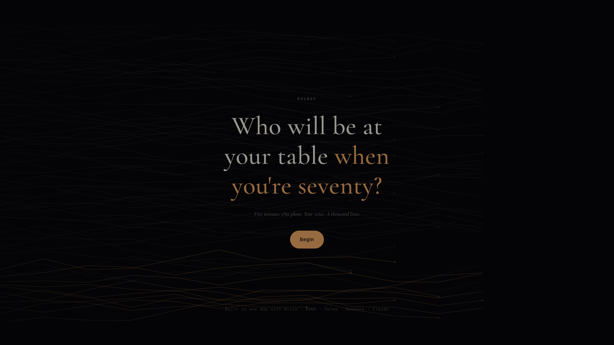
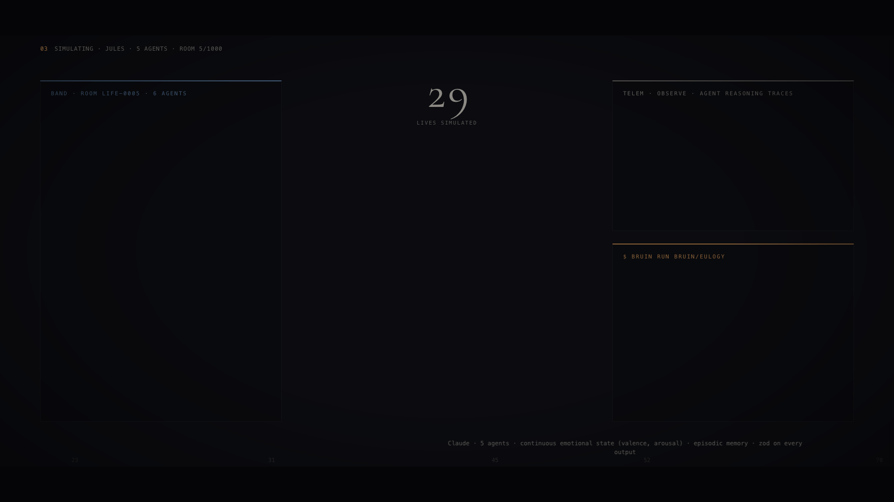
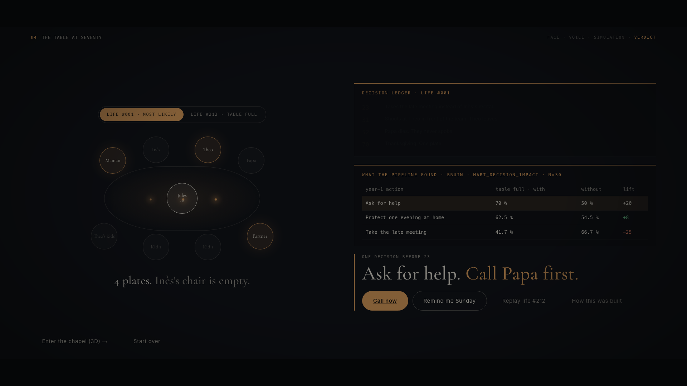

# Eulogy — the app

The demo you try after the film. Five screens, no typing, under five minutes.

| Step | Route | What happens | Real or scripted |
|---|---|---|---|
| Landing | `/` | The question. Life-lines drawing in the background. | real |
| Your face | `/face` | Webcam or upload. Runware FLUX.1 Kontext ages the photo twice (NOW / +25 / +50). | real when `VITE_RUNWARE_API_KEY` is set; otherwise a canvas look-dev fallback with the same UI |
| Tell us | `/voice` | You speak. Web Speech API streams the transcript; four guided prompts; a live extraction panel builds the profile (name, age, city, relatives as agents, flaws, fear). "Use demo profile" loads Jules. | speech recognition real (Chrome); extraction is a heuristic parser in `src/v2/extract.ts` |
| Simulation | `/simulate` | 30-second show: BAND room streaming public and private messages with your names, Destiny's veto and human gate; the thousand-lives canvas; Telem traces with the agent's reasoning; `bruin run` ticking 12 assets then the mart query. | scripted replay (`src/v2/script.ts`) of what the pipeline produced; the Telem queries, Bruin asset names and mart rows are the real ones from the repo |
| Verdict | `/result` | "In N % of your lives, X's chair is empty." Then the table at seventy (life #001 vs #212), the ledgers, the mart table, and one decision: Ask for help. Call X first. | N and the mart rows are read from `public/data/marts.json` (Bruin export); table and ledgers are templated with your names |





## Run
```bash
npm install
npm run dev -w apps/web      # http://localhost:5173
```
Optional: `VITE_RUNWARE_API_KEY` in `apps/web/.env.local` turns the aging step into real Runware calls from the browser.

## Where things live
- `src/v2/` — the five screens, theme, store, extraction, aging, show script.
- `src/pages/Chapel.tsx` — the 3D chapel (reachable from the verdict screen).
- `public/data/marts.json` — Bruin mart export used on screen.
