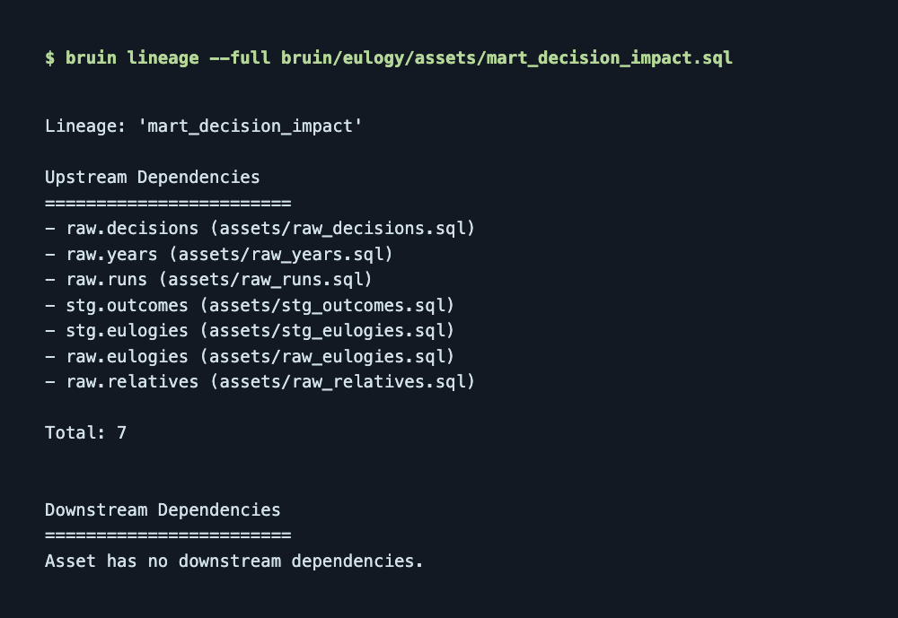
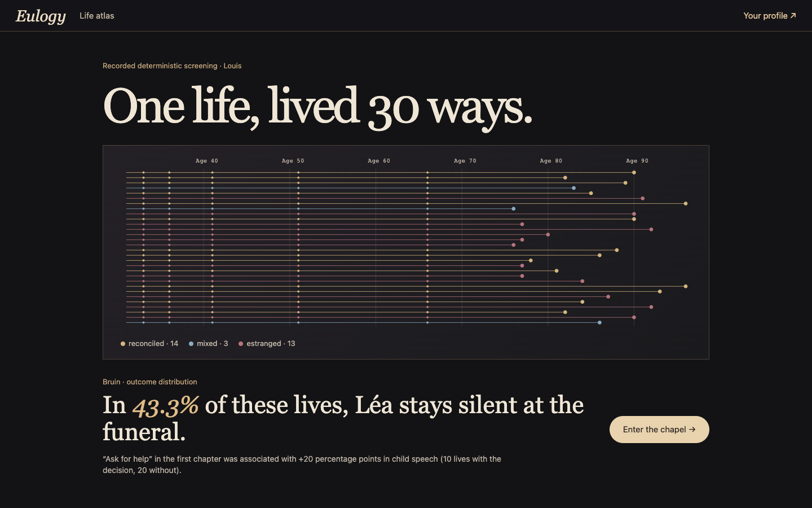
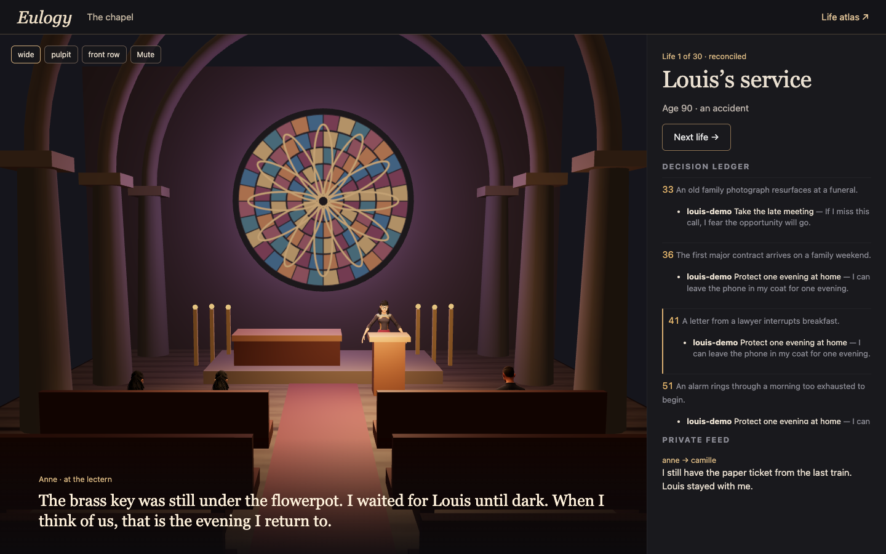

# Screening evidence

The published profile is Louis, age 31, with Camille, Léa, Anne and Jules in the cast. The main archive contains **30 seeded lives, 180 chapters and 120 farewells**. All 180 chapter records are marked `mock`. The original SQL and browser measurements used these files. The current local audio catalogue also includes two authored lives of Jules. [Louis’s profile](../data/profiles/louis.json) · [Run archive](../data/runs/louis-demo.jsonl) · [Summary](../data/runs/louis-demo.summary.json) · [Jules’s screening](../data/screenings/jules.json)

## Bruin execution

From the repository root, Bruin v0.11.832 produced the following output for `bruin run bruin/eulogy`. The full transcript includes each asset and check. The required `ci` job also validates the pipeline, runs it and verifies that re-exporting the marts leaves the published file unchanged. [Full terminal output](assets/bruin-run.txt) · [CI workflow](../.github/workflows/ci.yml)

```text
PASS raw.relatives
PASS raw.runs ...
PASS raw.years
PASS raw.eulogies .
PASS raw.private_messages
PASS raw.decisions
PASS stg.eulogies ..
PASS raw.relative_states .
PASS mart_turning_points
PASS stg.outcomes
PASS mart_outcome_distribution
PASS mart_decision_impact .


bruin run completed successfully in 20ms

 ✓ Assets executed      12 succeeded
 ✓ Quality checks       8 succeeded
```

The image reproduces the command output for the decision mart. [Verbatim lineage output](assets/lineage.txt)



## First decisions and child speech

```sh
bruin query -c duckdb-default -q 'SELECT action, pct_speaks_with, pct_speaks_without, lift, n, n_without FROM mart_decision_impact ORDER BY lift DESC'
```

```text
┌─────────────────────────────┬─────────────────┬────────────────────┬──────┬────┬───────────┐
│ ACTION                      │ PCT_SPEAKS_WITH │ PCT_SPEAKS_WITHOUT │ LIFT │ N  │ N_WITHOUT │
├─────────────────────────────┼─────────────────┼────────────────────┼──────┼────┼───────────┤
│ Ask for help                │ 70              │ 50                 │ 20   │ 10 │ 20        │
│ Protect one evening at home │ 62.5            │ 54.5               │ 8    │ 8  │ 22        │
│ Take the late meeting       │ 41.7            │ 66.7               │ -25  │ 12 │ 18        │
└─────────────────────────────┴─────────────────┴────────────────────┴──────┴────┴───────────┘
```

Léa spoke in **7/10** lives beginning with “Ask for help” and **10/20** other lives, a difference of **20 percentage points** in this screening. Each life contributes at most once to a given action cohort. Rates compare simulated outcomes from the same starting profile. [Original query output](assets/decision-impact.txt) · [SQL](../bruin/eulogy/assets/mart_decision_impact.sql) · [Export](../apps/web/public/data/marts.json)

## Endings

| Ending | Lives | Share of the 30 |
|---|---:|---:|
| Reconciled | 14 | 46.7% |
| Estranged | 13 | 43.3% |
| Mixed | 3 | 10.0% |
| Admired, not loved | 0 | 0.0% |

Léa speaks in 17 lives and stays silent in 13. Camille also speaks in 17. Their percentages are calculated separately using role IDs. The representative life is `louis-demo-0001`. The best-scoring reconciled life is `louis-demo-0028`. Life 29 is an estranged ending in which every seat remains occupied. [Summary](../data/runs/louis-demo.summary.json) · [JSONL records](../data/runs/louis-demo.jsonl)

## Three voices from the recorded lives

The table quotes three farewell records as written by the seeded narrator. Each final score determines whether that witness speaks. The local recording script draws on the speaking witness’s own memories and decisions for the words heard in the chapel. [Run archive](../data/runs/louis-demo.jsonl) · [Staged lines](../packages/shared/src/funeralScript.ts)

| Run and relative | Final score | Delivery | Farewell |
|---|---:|---|---|
| `louis-demo-0001` · Anne | 91 | Spoken | The brass key was still under the flowerpot. I waited for Louis until dark. When I think of us, that is the evening I return to. |
| `louis-demo-0025` · Jules | 55 | Spoken | The telephone rang while the soup went cold. Louis stayed with me. When I think of us, that is the evening I return to. |
| `louis-demo-0028` · Léa | 100 | Spoken | I still have the paper ticket from the last train. Louis stayed with me. When I think of us, that is the evening I return to. |

In `louis-demo-0006`, Léa remembers the same train ticket as in life 28, but her final score is 29. The chapel keeps her line in the private feed. Jules’s score of exactly 55 in life 25 illustrates the inclusive boundary.

## Browser screening





Chrome 158 on a MacBook Air M5 rendered a 1051×844 WebGL canvas in a 1440×900 viewport at DPR 1. A windowed sample captured **186 rendered intervals in 6.2 seconds, or 30.0 fps**. The blank-page reference measured 29.84 fps. At a 390 px mobile width all four routes fit. The camera test used Chrome’s synthetic media input and the upload test supplied a PNG. [Measurements and replay steps](assets/browser-check.json)

A second test kept VSync active on the 60 Hz Retina panel. With Chrome Energy Saver disabled in a temporary profile, the three camera shots each rendered 330 frames in about 5.5 seconds on a 1576×951 drawing buffer. A separate foreground compositor trace recorded 365 presented frames across 6.067 seconds, or **60.000 fps**, with a 16.667 ms p95 presentation interval and a 33.333 ms maximum. With default power settings at 11% battery, the chapel and the blank control both ran at 30 fps. [Comparison](assets/chapel-performance-summary.json) · [Retina samples](assets/chapel-performance-retina-2026-11-23.json) · [Compositor measurements](assets/chapel-retina-presentation-summary.json) · [Presentation events](assets/chapel-retina-compositor-trace.json.gz)

| Camera | WebGL frames/s, Retina | p95 GPU time |
|---|---:|---:|
| Wide | 60.008 | 2.343 ms |
| Pulpit | 60.007 | 2.013 ms |
| Front row | 59.989 | 2.179 ms |

In the original browser test, Jules stayed seated in life 1. Anne, Léa and Camille each played a complete audio clip. The decision ledger advanced through all six chapter ages. The next two screenings were lives 28 and 29. Disabling WebGL preserved captions, navigation and audio controls. The two featured lives in that test used six macOS voice recordings. [Original browser results](assets/browser-check.json)

The current local archive has 32 Destiny openings and 62 spoken witness passages. Eight stock Kokoro voices perform them in 90 MP3s. All 90 files decoded as 24 kHz mono audio, and Chrome 158 played a sample from each performer. The coverage test checks every spoken cue, leaves 66 silent witnesses without audio and rejects a previous line when a new run reuses the same IDs. [Audio catalogue](../apps/web/src/data/audio.json) · [Corpus tests](../apps/web/src/data/funeralAudio.test.ts) · [Cast and generator](../scripts/voices.md)

## Thousand-life replay

```sh
npm run ensemble
```

The independent replay produced 1,000 distinct run IDs and 6,000 deterministic chapters. It classified 466 reconciled, 265 mixed, 254 estranged and 15 admired-not-loved endings. The child spoke in 69.9% of this larger ensemble. The atlas uses its own 30-life denominator. The complete JSONL is generated locally in `.local/ensemble/`. [SHA-256 and counts](assets/ensemble-1000.json)

## Service receipts

| Service | Observed status and artifact |
|---|---|
| Anthropic / Vercel AI Gateway | The model ID is configured and the retry path is covered by tests. The hosted project identity reached AI Gateway on November 23. The provider returned HTTP 403 with `customer_verification_required` before inference because the team requires a card on file. There is no authenticated Claude chapter in the committed screening. [Model transport](../packages/sim/src/chapter.ts) · [Status record](assets/model-access.json) |
| BAND | **Dry run.** One request trace and 30 room transcripts contain 1,080 public posts, 180 addressed messages and 30 gate events. The veto and human identity checks were exercised with a simulated transport. [Requests](../data/band/requests.json) · [Transcript](../data/runs/louis-demo.band.jsonl) · [Tests](../packages/sim/src/band.test.ts) |
| Telem | **Dry run.** Five search requests carry Destiny's reasoning in `metadata.context`. The published weights use the defaults, with no live source URL. [Requests](../data/telem/requests.json) · [Weights](../data/priors/louis-demo.json) |
| Runware | **Dry run.** Receipts include FLUX Kontext `bfl:3@1`, text-only portraits, environment textures, TRELLIS.2 `microsoft:trellis-2@4b` and a poll request. The chapel uses the three local procedural textures and bundled Ready Player Me rigs. [Requests](../data/runware/requests.json) · [Textures](../apps/web/public/textures/) · [Avatar attribution](../apps/web/public/avatars/CREDITS.md) |
| Vercel | Four function contracts validate input and check the required services. A local build using the Vercel Node builder started each function separately and observed its credential-free HTTP 501 response. [API tests](../apps/web/api/routes.test.ts) · [Function configuration](../vercel.json) |

## Public deployment

The public deployment check used source commit `392f15f90b4634cdc79cfcc8522ac3bd3ad479ed`. All 23 unauthenticated HTTP checks passed, including the four HTML routes, bundles, models, the original six voice clips, textures and BAND transcript. Chrome played the intro, submitted the profile, showed the 43.3% atlas result and advanced from life 1 to life 28 in the chapel. The browser reported zero JavaScript or asset errors. [Live demo](https://eulogy-ochre.vercel.app/) · [HTTP results](assets/production-http.json) · [Browser trace](assets/production-browser.json)

Private Vercel Blob storage accepted a 68-byte test PNG. Its time-limited signed read returned the identical SHA-256, and the unsigned read returned HTTP 403. On the public form, a missing name produced an inline error, a saved name survived reload and the synthetic webcam produced a JPEG preview. The unconfigured model and portrait endpoints returned HTTP 501 and the form opened the published screening. [Storage check](assets/production-blob.json) · [Form check](assets/production-form.json)

## Film

Louis delivered the final cut at 17:05 San Francisco time. The exported composition is `Eulogy`, 3,516 frames at 24 fps, or 2 minutes 26.5 seconds. FFprobe verified 1920×1080 H.264 video and 48 kHz stereo AAC in the 78,574,774-byte MP4. [Export metadata and SHA-256](assets/film-export.json) The interactive screening above follows Louis, while the film follows Jules. The source credits Remotion, Higgsfield, Kling and ElevenLabs. An AdaL provider receipt has not been published. [Watch the final film](https://eulogy-hackathon-film.vercel.app/) · [Final cut](https://github.com/louisktj/eulogy/commit/6361a81) · [Composition](../video/src/Film.tsx) · [Organizer portal](https://hackathons.crewbasecollective.com/h/12/submit)
